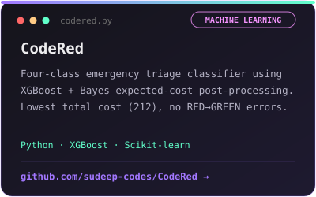

  

  
  
  
  
  

  3rd-year B.Tech CSE student at <b>VIT Vellore</b> (CGPA 8.36/10). 
  I build full-stack web apps and AI/ML projects, and I'm open to <b>SDE, full-stack, and AI/data internships</b>.

### 👨‍💻 About Me

  

### 🚀 Featured Projects

<table align="center">
  <tr>
    <td width="33%"></td>
    <td width="33%"></td>
    <td width="33%"></td>
  </tr>
</table>

### 💻 Tech Stack

<table align="center">
  <tr>
    <td><b>Languages</b></td>
    <td></td>
  </tr>
  <tr>
    <td><b>Web</b></td>
    <td></td>
  </tr>
  <tr>
    <td><b>Data &amp; Backend</b></td>
    <td></td>
  </tr>
  <tr>
    <td><b>Tools</b></td>
    <td></td>
  </tr>
  <tr>
    <td><b>ML &amp; AI</b></td>
    <td>
      
      
      
      
      
    </td>
  </tr>
</table>

### 📊 GitHub Stats

  
  

  

### 🐍 Contribution Snake

  <picture>
    <source media="(prefers-color-scheme: dark)" srcset="https://raw.githubusercontent.com/sudeep-codes/sudeep-codes/output/github-snake-dark.svg">
    
  </picture>

